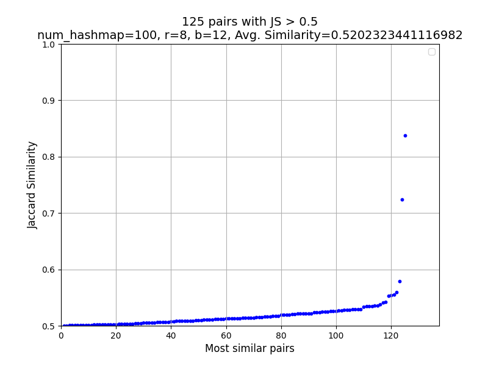
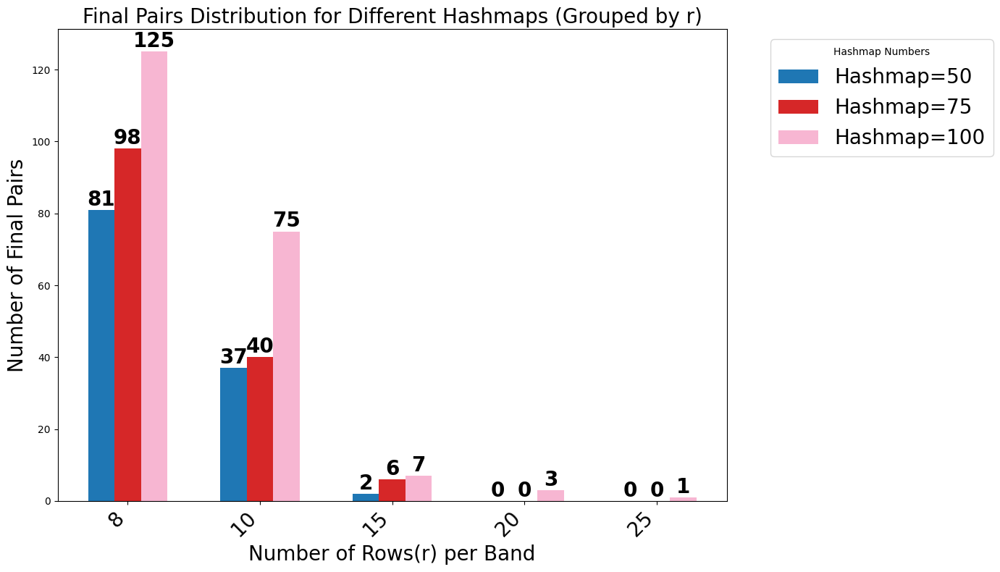
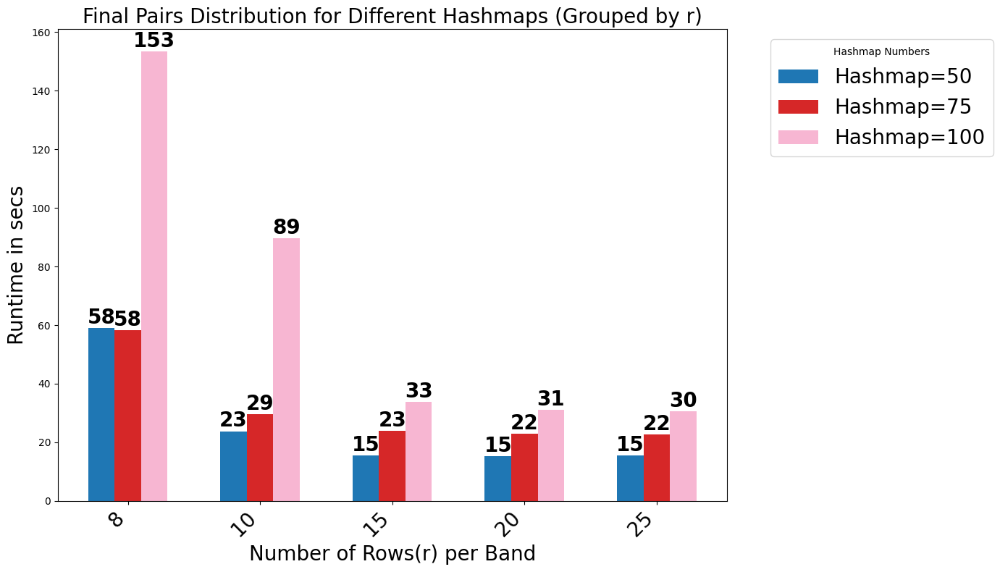

# Scalable Near-Duplicate Detection with MinHash and LSH

Finds similar users in the Netflix Prize ratings data (65 million records, ~100,000 users, 17,770 movies) without comparing every pair of users. Each user is represented by the set of movies they rated. MinHash signatures with banded locality-sensitive hashing (LSH) narrow billions of possible pairs down to a few hundred thousand candidates, and only those candidates get an exact Jaccard similarity check. This is the same approximate nearest-neighbour approach used for entity resolution and duplicate detection at scale.

## Pipeline

```text
Netflix ratings
    -> filter users by rating count
    -> user-movie CSR matrix
    -> MinHash signature matrix
    -> banded locality-sensitive hashing
    -> unique candidate user pairs
    -> exact Jaccard similarity
    -> pairs with similarity > 0.5
```

1. **Sparse representation:** the `(user, movie, rating)` triples are loaded into a SciPy CSR matrix. A rating only marks that the user rated the movie; its value isn't used in the Jaccard similarity.
2. **MinHash:** 100 random permutations of the movie IDs give a 100 × users signature matrix. The fraction of matching signature rows estimates the Jaccard similarity between two users.
3. **LSH banding:** signatures are split into 12 bands of 8 rows. Users that land in the same bucket for any band become candidate pairs.
4. **Verification:** the exact Jaccard similarity is computed for each candidate pair, and pairs above 0.5 are kept.

## Results

| Setting | Value |
|---|---|
| Random seed | 5 |
| MinHash signature length | 100 |
| Rows per band / bands | 8 / 12 |
| Similarity threshold | Jaccard > 0.5 |
| Input records | 65,225,506 |
| Candidate pairs from LSH | 409,006 |
| Final user pairs above threshold | **125** |
| Mean Jaccard similarity of final pairs | ≈ 0.52 |



*Figure 1. Jaccard similarity scores for the 125 user pairs above the 0.5 threshold.*

### Parameter study

Signature length and rows per band trade recall against runtime. Fewer rows per band put more pairs in the same buckets, so more true pairs are found, at a higher compute cost.



*Figure 2. Number of final pairs for different signature lengths and rows per band.*



*Figure 3. Runtime for different signature lengths and rows per band.*

## Repository contents

| Path | Description |
|---|---|
| [`lsh_similar_users.py`](lsh_similar_users.py) | Final pipeline: CSR matrix → MinHash → LSH → Jaccard filtering → results and plot |
| [`experiments/csr_matrix_version.py`](experiments/csr_matrix_version.py) | Earlier CSR-based implementation |
| [`experiments/coo_matrix_version.py`](experiments/coo_matrix_version.py) | COO sparse-matrix experiment |
| [`experiments/csc_matrix_version.py`](experiments/csc_matrix_version.py) | CSC sparse-matrix experiment |
| [`experiments/dok_sparse_version.py`](experiments/dok_sparse_version.py) | DOK sparse-matrix experiment |
| [`experiments/dense_numpy_version.py`](experiments/dense_numpy_version.py) | Dense NumPy baseline |

## Setup

```bash
python3 -m venv .venv
source .venv/bin/activate
python -m pip install -r requirements.txt
```

Place the preprocessed Netflix array at the repository root as `user_movie_rating.npy`, with one `user_id, movie_id, rating` row per rating. The data file isn't included in this repository.

```bash
python lsh_similar_users.py
```

The script writes the identified user pairs to `result.txt` and shows a plot of their Jaccard similarity scores. The NumPy random seed is fixed, so the MinHash sampling is reproducible.

## Team

Built at Leiden University by Priyanjali Goel, Po-Chin Chang, Praneeth Dathu and Luuk Deen.
